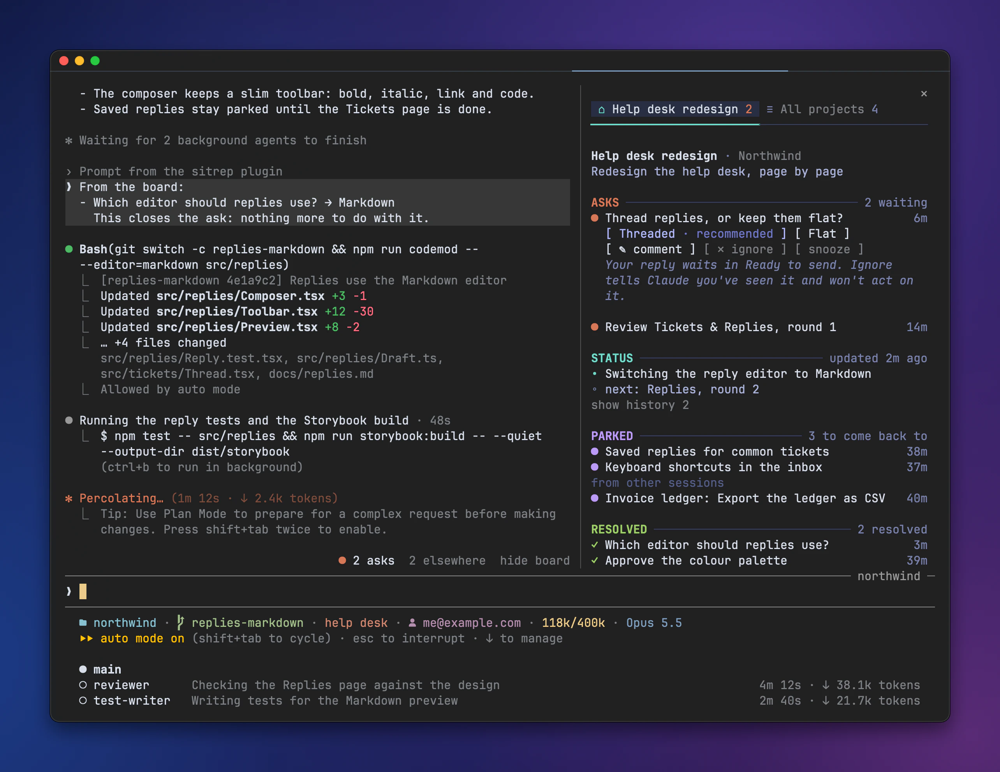

<div align="center">


# SitRep

**A board for your Claude Code sessions**

Claude keeps a board as it works: where each session stands, what it needs from you, and what it put off for later. You see it in Claude Code and at the edge of your Mac's screen, answer from it, and a click takes you to the window a session is in.

[](#install)
[](https://www.swift.org)
[](#install)
[](LICENSE)

[Screens](#screens) · [Install](#install) · [Quick start](#quick-start) · [Questions](#questions-you-may-have) · [Docs](docs/README.md) · [Contributing](CONTRIBUTING.md) · [Design](DESIGN.md)

</div>

---

## Why SitRep?

With several Claude Code windows open across several projects, what waits on you is spread through their chats. A question Claude asked an hour ago, in a window you've left, waits there unseen.

- **The chat stays primary.** Claude talks to you in the chat as it always does, and also puts a line on the board. Nothing moves out of the chat. [How Claude keeps the board](docs/claude-and-sitrep.md)
- **What waits on you, in one place.** Claude posts an ask for whatever only you can do or decide. Every ask, across every project, is counted above the prompt and lit at the edge of your screen. The edge also lights every session where Claude has stopped and it's your turn. [Asks: what waits on you](docs/asks.md)
- **Answer without hunting.** A yes or a choice is a button, with the option Claude recommends marked. Your reply reaches Claude as your own message, in its own window. [Answering from the board](docs/answering.md)
- **Answer from the edge of your screen.** In the notch, point at a session with an ask, and an arrow shows. A click on the arrow opens the asks panel beside it. One click answers a yes or a choice, with two seconds to undo. Or press ⌃⌥S, and answer from the keyboard. [Answering from the edge of your screen](docs/answering-edge.md)
- **A click takes you there.** Click a session, and SitRep brings forward the Ghostty window showing it, on any Space. That works inside tmux, inside [zmx](https://github.com/neurosnap/zmx), a tool that keeps terminal sessions to attach to, or in neither. If no window shows the session, SitRep resumes it in a new one. [A click takes you there](docs/jump.md)
- **Sessions outlive their windows.** After a `/clear`, or in a new Claude told to carry on, the session keeps its status, history and asks. What it parks stays with the project, and Claude moves a session to another project when you say so. [Sessions](docs/sessions.md)
- **Put a session off.** Snooze a session for an hour, until tonight, until next week, or until it moves. Until it wakes, nothing it holds counts as waiting on you. Settings › Snooze sets which timed choices you see, and when each wakes. [Putting a session off](docs/snooze.md)
- **The board in any terminal.** Type `sitrep` in a Ghostty tab, or over SSH from a phone, and the board fills the terminal. Open a session from it with your resume command. [The board in any terminal](docs/terminal.md)

## Screens



**[The board in Claude Code](docs/pane.md).** Docked beside the conversation, it holds what this session needs from you, answered in place.


**[The notch](docs/notch.md).** At the edge of your screen, it lights while something needs you, and opens on hover to every session, a click from its window.

## Install

You need an Apple silicon Mac on macOS 14 or later, and Claude Code 2.1.326 or later. Ghostty is recommended, not required.

```bash
brew install --cask leeovery/tools/sitrep
```

Then open SitRep from Applications. On its first start, SitRep installs the sitrep plugin into Claude Code.

To update, run `brew upgrade --cask sitrep`. To remove SitRep and its plugin, follow [Installing and removing SitRep](docs/install.md), which also says what the install sets up.

## Quick start

```text
# In each Claude Code window already open
/reload-plugins
# Open the board in Claude Code
/sitrep
```

Then work as you do. When the work runs across several turns or needs you, Claude starts a session and keeps the board. The line above the prompt counts the asks waiting on you, and each count opens the board.

To see every session, move the pointer onto SitRep's notch, at the left edge of your main display. Click a session to jump to its window.

## Questions you may have

- **Do I need Ghostty?** No. The board works in any terminal. With Ghostty, a click brings forward the exact window. Any other terminal app is brought forward whole, and only Ghostty opens a new window to resume a session. [A click takes you there](docs/jump.md)
- **Where does the board live?** In a folder of files on your Mac, `~/.local/state/sitrep`. There is no server, account or database.
- **Can Claude snooze or finish my sessions?** Claude can finish a session once its work is done. Only you can snooze one. [How Claude keeps the board](docs/claude-and-sitrep.md)
- **What if Claude misses an update?** Nothing breaks. The board shows only what Claude posted, and never claims Claude knows more. [How Claude keeps the board](docs/claude-and-sitrep.md)
- **What does SitRep ask macOS for?** At the first open, macOS asks once whether to open an app downloaded from the internet. At the first start, the welcome window turns on Open at login, and its **Turn On…** turns on banners for a new ask. Otherwise banners stay off until you turn them on in Settings › Notifications. At your first click on a session, SitRep asks to control Ghostty, which you can also allow in Settings › General. For keys at the notch, allow Accessibility in Settings › Edge. [Installing and removing SitRep](docs/install.md)

## Where next

- [The docs](docs/README.md): every page, by task.
- [The `sitrep` command](docs/cli.md): every command and flag.
- [Settings, pane by pane](docs/settings.md): every control, with its default.
- [CONTRIBUTING.md](CONTRIBUTING.md): how the parts fit, and building, testing and releasing SitRep.
- [DESIGN.md](DESIGN.md): the design record, every decision and why.

## License

[MIT](LICENSE)
