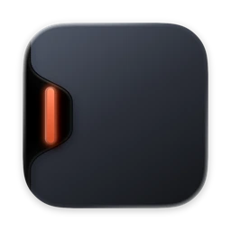
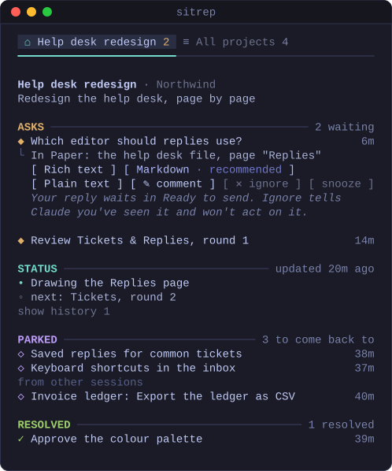
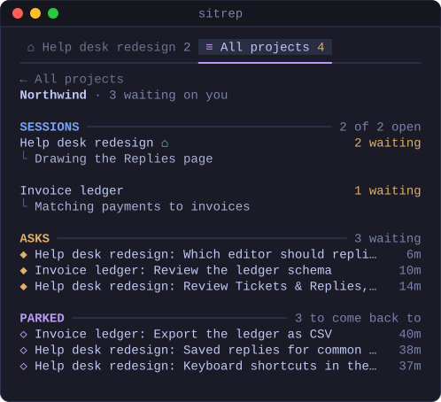
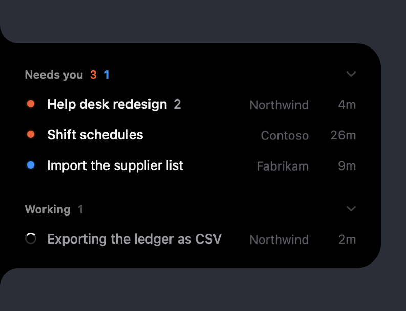
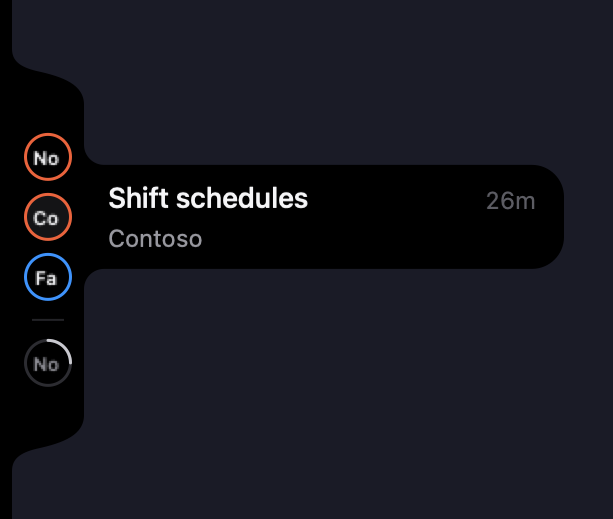
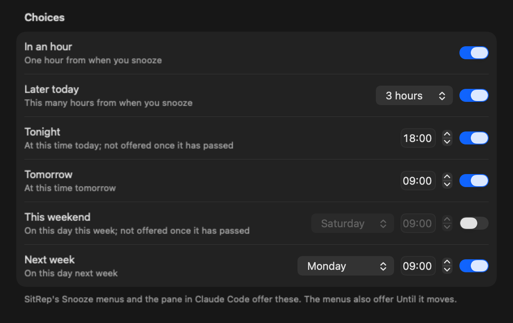

<div align="center">



# SitRep

**A board for your Claude Code sessions**

Claude keeps a board as it works: where each session stands, what it needs from you, and what you'd want to know later. You see it in Claude Code and at the edge of your Mac's screen, answer from it, and a click takes you to the window a session is in.

[](#install)
[](https://www.swift.org)
[](#questions-you-may-have)

[Screens](#screens) · [Install](#install) · [Quick start](#quick-start) · [Questions](#questions-you-may-have) · [Design](DESIGN.md) · [Contributing](CONTRIBUTING.md)

</div>

---

## Why SitRep?

With several Claude Code windows open across several projects, what waits on you is spread through their chats. A question Claude asked an hour ago, in a window you've left, waits there unseen.

- **The chat stays primary.** Claude talks to you in the chat as it always does, and also puts a line on the board. Nothing moves out of the chat.
- **What waits on you, in one place.** Claude posts an ask for whatever only you can do or decide. Every ask, across every project, is counted above the prompt and lit at the edge of your screen. So is every session where Claude has stopped and it's your turn.
- **Answer without hunting.** A yes or a choice is a button, with the option Claude recommends marked. Your reply reaches Claude as your own message, in its own window.
- **A click takes you there.** Click a session, and SitRep brings forward the Ghostty window showing it, on any Space, in tmux, zmx or neither. If no window shows the session, SitRep resumes it in a new one.
- **Sessions outlive their windows.** After a `/clear`, or in a new Claude told to carry on, the session keeps its status, history and asks. What it parks stays with the project, and Claude moves a session to another project when you say so.
- **Put a session off.** Snooze a session for an hour, until tonight, until next week, or until it moves. Until it wakes, nothing it holds counts as waiting on you. Settings › Snooze sets which choices you see, and their times.

## Screens

|  |  |
|:---:|:---:|
| <br>**The pane**<br>What this session needs from you, answered in place | <br>**A project**<br>Every session of a project, and all it waits on |
| <br>**The notch**<br>Every session at the edge of your screen, a click from its window | <br>**The strip**<br>A ring for each session, its words a hover away |
| <picture><source media="(prefers-color-scheme: light)" srcset="art/screens/settings-snooze-light.png"></picture><br>**Settings › Snooze**<br>When each of Snooze's choices wakes a session | |

## Install

You need an Apple silicon Mac on macOS 14 or later, and Claude Code. Ghostty is recommended, not required.

```bash
brew install --cask leeovery/tools/sitrep
```

Then open SitRep from Applications. On its first start, SitRep installs the sitrep plugin into Claude Code. If that fails, the menu in the menu bar says why.

To update, run `brew upgrade --cask sitrep`. If SitRep was running, the new one starts by itself and updates the plugin.

To remove SitRep, run `brew uninstall --cask sitrep`. The plugin stays in Claude Code until you remove it too:

```bash
claude plugin uninstall sitrep@sitrep
claude plugin marketplace remove sitrep
```

## Quick start

```text
# In each Claude Code window already open
/reload-plugins
# Open the board in Claude Code
/sitrep
```

Then work as you do. When the work runs across several turns or needs you, Claude starts a session and keeps the board. The line above the prompt counts what waits on you, and each count opens the board.

To see every session, move the pointer onto SitRep's notch, at the left edge of your main display. Click a session to jump to its window.

## Questions you may have

- **Do I need Ghostty?** No. The board works in any terminal. With Ghostty, a click brings forward the exact window. Any other terminal app is brought forward whole, and only Ghostty opens a new window to resume a session.
- **Where does the board live?** In a folder of files on your Mac, `~/.local/state/sitrep`. There is no server, account or database.
- **Can Claude snooze or finish my sessions?** Claude can finish a session once its work is done. Only you can snooze one.
- **What if Claude misses an update?** Nothing breaks. The board shows only what Claude posted, and never claims Claude knows more.
- **What does SitRep ask macOS for?** Nothing at install. In Settings › General you can let SitRep control Ghostty and open at login. Its macOS notifications stay off until you turn them on in Settings › Notifications.

## Where next

- [DESIGN.md](DESIGN.md): how every part works, and why.
- [CONTRIBUTING.md](CONTRIBUTING.md): how the parts fit, Claude's tools, the CLI, and building, testing and releasing SitRep.
