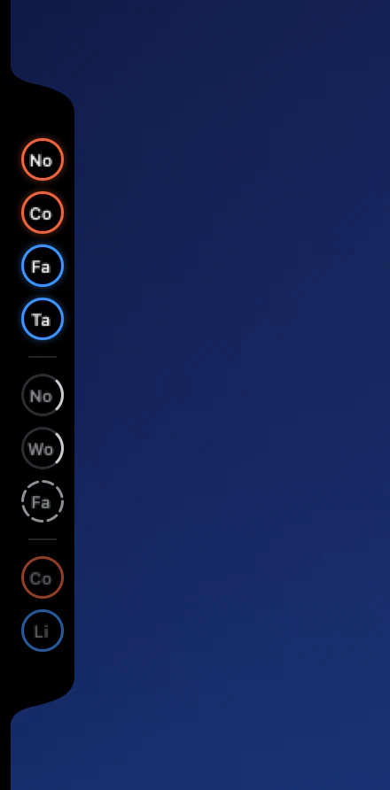

# The edge of your screen: the notch, the strip and the menu bar

SitRep shows the board at the edge of your Mac's screen, whatever app you are in. The notch lights up when a session needs you, and opens into a list of your sessions when you point at it. A click takes you to the session, so you never look through your windows.

*The notch opens when the pointer reaches it, and closes when the pointer leaves.*

## Try it

1. Move the pointer to the left edge of your screen, a little above the middle. The notch opens into the panel.
2. Click a row. SitRep takes you to the Claude Code window running that session.
3. To try the strip, click the SitRep icon in the menu bar, and choose **Strip** under Show.

## What happens

- **The panel lists your sessions in three sections.** Needs you comes first, then Working, then Snoozed. Working also holds the sessions that wait on work of their own. A click on a section heading folds it, and Snoozed starts folded.
- **A click on a row jumps.** See [A click takes you there](jump.md). A right-click gives the row a menu, with **Jump to the window**. A row with asks or a Stopped row adds **Snooze**. A row in Snoozed adds **Wake now**. See [Putting a session off](snooze.md).
- **An arrow opens the asks panel.** Point at a row with an ask, and an arrow shows at its right end. See [Answering from the edge of your screen](answering-edge.md).
- **The notch shows what waits.** While something needs you, the notch grows and lights. The light is orange while an ask or a permission prompt waits. With neither, it is blue while a session is Stopped. By default, a new ask or a new permission prompt makes it swell twice and flash.
- **You can move it.** Drag the notch along the edge. Past the middle of the screen, it moves to the other edge.
- **The strip can stand in for the notch.** It is a narrow column with a mark for each session, and the colour of the ring says where the session stands. Point at a mark to see its row. A click jumps, and a right-click gives the row menu.
- **The menu bar item lists the same sessions, except the snoozed ones.** Its icon lights orange or blue, the same way the notch does. Its menu gives one total, such as "3 need you", over a row for each session to click. Under Show, you choose Notch, Strip or Nothing: with Nothing, the icon is the only light.

## Good to know

- **It never takes the keyboard.** Your typing stays in the app you were in. There is no Esc: move the pointer away and the panel closes.
- **Dimmed rows still work.** SitRep dims a session that no terminal on this Mac shows. A click on one resumes the session: see [A click takes you there](jump.md).
- **Full-screen apps come first.** While one has the display, the notch and the strip leave that display. They come back when the app leaves full screen.
- **The menu speaks up first.** Above the sessions, it says when the plugin is in trouble. Under "Needs /reload-plugins", it lists each window on an older plugin, until you run `/reload-plugins` there. A click on one takes you to it. If the board stops updating, the menu says "SitRep can't read the board" and why.

## Reference

| A mark on the strip | Means |
|---|---|
| Orange ring | Needs you: an ask or a prompt |
| Blue ring | Stopped: your turn |
| Grey ring, arc turning | Working |
| Dotted grey ring | Waiting on work of its own |
| Faint ring and letters | Snoozed |
| Lit ring, dim letters | Waits on you, but no terminal on this Mac shows it |
| A number, such as "+3" | More sessions than the section has room for |
| A number with no plus, such as "3" | A folded section; Snoozed starts folded |

At **Grows**, the default, the strip is as long as its marks need. At **Full**, it runs the height of the screen. Both are in Settings › Edge.

## Related

- [Sounds, banners and the pulse](notifications.md)
- [Settings, pane by pane](settings.md)
- [Asks: what waits on you](asks.md)
